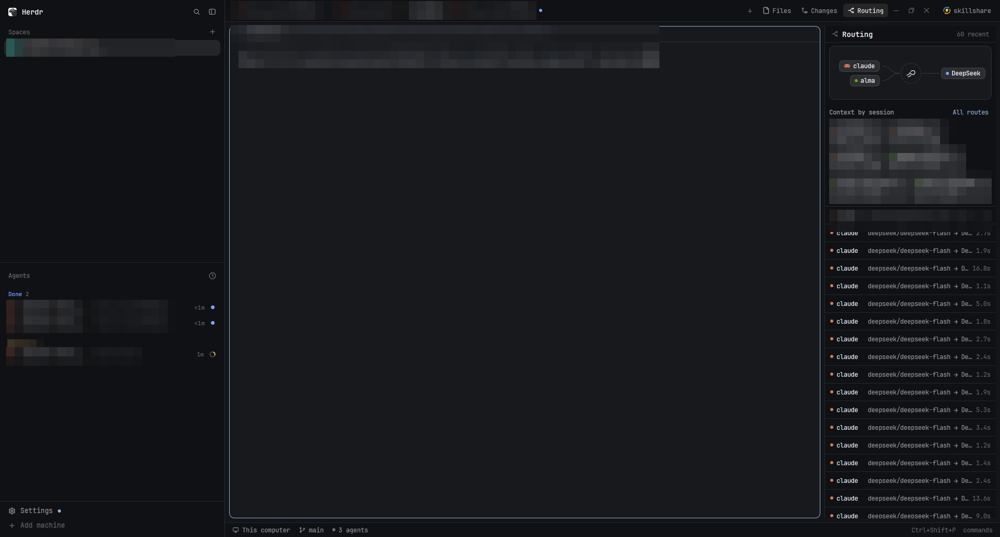
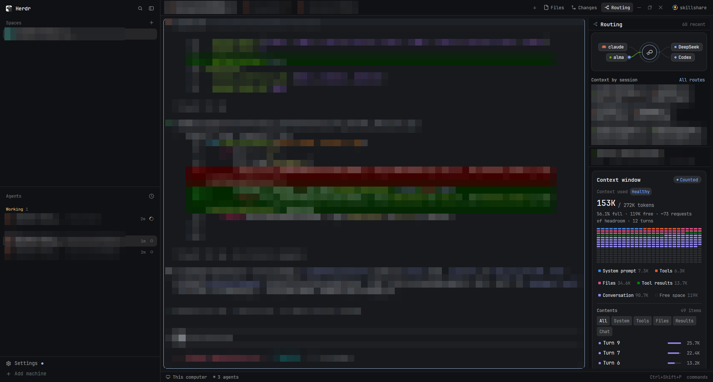

# Magpie Routing v1 — Herdr 布局发布包

一个面向 Herdr（herdr-app）的自包含布局包：左侧是 Spaces / Agents 导航，中间是终端工作区，
右侧是 Magpie routing 实时面板，顶部标签栏带有 skillshare 面板开关。

- 布局名：`magpie-routing-v1`
- 包版本：见 [`VERSION`](VERSION)（当前 `1.0.1`）
- README 截图：`layouts/layout.png` 与 `layouts/contextwindow.png`（已对个人及项目内容做马赛克）
- Herdr 布局选择器仍使用 `layouts/magpie-routing-v1.svg` 作为小型预览图。

### 主布局



### Context window



## 目录结构

```
herdr-routing-layout/
  VERSION
  README.md
  layouts/
    magpie-routing-v1.json     新布局（复制自当前 herdr-skillshare 布局并固化当前尺寸）
    magpie-routing-v1.svg      Herdr 布局选择器使用的示意预览
    layout.png                 已打码的完整 Routing 布局截图
    contextwindow.png          已打码的 Context window 截图
  mods/
    routing/                   非内置：Magpie routing 面板
      main.js
      mod.json
      bird.svg
      route.svg
    skillshare/                非内置：skillshare 面板
      main.js
      mod.json
      channel.js
      jobs.js
      loader.js
      model.js
      operations.js
      mark.svg
      icons/*.svg
    tabs-routing/              非内置：克隆自内置 tabs 的标签栏
      main.js
      mod.json
      win-min.svg
      win-max.svg
      win-close.svg
      win-restore.svg
```

包内**没有**内置 mods（`spaces`、`agents`、`pane`、`files`、`changes`、
`workspace-chrome`、`workspace-status`、`menu` 等由 Herdr 自带），也没有
`gpui-kit.d.ts`、`jsconfig.json`、缓存、日志或 `node_modules`。

## Herdr 版本兼容要求

- **已验证版本：Herdr app `0.1.14`**（Windows，`herdr-app 0.1.14`）。
- 布局结构复制自 `main 0.1.12` 的克隆，标签栏 mod 克隆自内置 `tabs 0.1.14`。
- 布局使用了当前布局 schema 中的 `titlebar`、`traffic_lights`、`pane.lone`、
  `pane.header`、`window_drag`、主题明暗对（`theme: {light, dark}`）等字段；
  Mod 使用了 `settings().ui_font_size`、`window().buttons`、`watchFolder()`、
  `home()`、`openOverlay()`、`nextCommand()` 等 API。
- 建议使用 **Herdr app 0.1.14 或更新的 0.1.x**。更旧的 0.1.x 可能缺少上述字段/API，
  不保证正确渲染。升级 Herdr 后若布局或 mod 报错，请先看 `herdr-app status` 与
  `layouts/magpie-routing-v1.error`、`*.error` 文件。
- `herdr-app` 与 `hc`（herdr-core）是两个程序；本包只依赖 `herdr-app` 的布局/mod 系统，
  不要求特定 `herdr-core` 版本。终端与 agent 功能由用户自己的 Herdr 环境决定。

## 可选运行前提

布局本身可以只靠 Herdr 内置 mods 运行，但两个面板需要外部工具/数据才有内容：

| 面板 | 需要 | 缺少时 |
|---|---|---|
| `routing` | Magpie 写入的 `~/.config/magpie/routing/<本地日期>.jsonl` | 显示等待请求的空状态；不影响 Herdr |
| `skillshare` | `skillshare` CLI 在该空间的机器上可用（建议在 `PATH`，mod 也会补 `~/.local/bin`、`~/go/bin`、Homebrew 路径） | 面板显示 “skillshare not found” 或读取失败提示 |
| `tabs-routing` | 无额外依赖 | 仅标签栏功能 |

`routing` 只读取路由元数据文件，不发送网络请求；`skillshare` 会按用户操作执行
`skillshare` 命令，属于外部程序调用。

## 安装（复制式，不覆盖现有文件）

Herdr 的配置目录：

- Windows：`%USERPROFILE%\.config\herdr-app`
- macOS / Linux：`~/.config/herdr-app`

以下路径以 Windows PowerShell 为例；如配置目录不同，替换 `$HerdrHome`。

```powershell
$Pkg = "C:\path\to\herdr-routing-layout"
$HerdrHome = Join-Path $env:USERPROFILE ".config\herdr-app"

# 1. 复制布局与预览
Copy-Item "$Pkg\layouts\magpie-routing-v1.json" "$HerdrHome\layouts\" -ErrorAction Stop
Copy-Item "$Pkg\layouts\magpie-routing-v1.svg"  "$HerdrHome\layouts\" -ErrorAction Stop

# 2. 复制三个非内置 mods
Copy-Item "$Pkg\mods\routing"       "$HerdrHome\mods\" -Recurse -ErrorAction Stop
Copy-Item "$Pkg\mods\skillshare"    "$HerdrHome\mods\" -Recurse -ErrorAction Stop
Copy-Item "$Pkg\mods\tabs-routing"  "$HerdrHome\mods\" -Recurse -ErrorAction Stop
```

macOS / Linux 对应命令：

```sh
PKG="/path/to/herdr-routing-layout"
HERDR="$HOME/.config/herdr-app"
cp "$PKG/layouts/magpie-routing-v1.json" "$HERDR/layouts/"
cp "$PKG/layouts/magpie-routing-v1.svg"  "$HERDR/layouts/"
cp -R "$PKG/mods/routing" "$PKG/mods/skillshare" "$PKG/mods/tabs-routing" "$HERDR/mods/"
```

**不要覆盖已有文件。** 如果 `mods/routing`、`mods/skillshare` 或 `mods/tabs-routing`
已存在，请先改名或删除旧目录；若改名，布局 JSON 中对应的 `"mod"` 名称也要同步修改。
Herdr 自带的同名 mods 不是这三个名字，正常不会冲突。

安装后无需修改 `settings.json`、`keys.json` 或 `programs.json`。

## 激活与验证

Herdr 运行中会自动加载新文件。激活新布局：

1. 用 `ctrl-shift-l` 循环布局，或
2. 在命令面板选择该布局，或
3. 执行：

```sh
herdr-app do layout.switch '{"name":"magpie-routing-v1"}'
```

验证：

```sh
herdr-app check "<HerdrHome>/mods/routing"
herdr-app check "<HerdrHome>/mods/skillshare"
herdr-app check "<HerdrHome>/mods/tabs-routing"
herdr-app status
```

三个 `check` 都应输出 `check passed`。`status` 的 `errors` 应为空；切换布局后
终端、标签栏、routing 面板和 skillshare 开关都应出现。若要回到原布局，再次
`ctrl-shift-l`，或 `herdr-app do layout.switch '{"name":"main"}'`。

## 布局说明

- 左侧栏宽度固化为当前实际使用的 **431px**（上限 480）。
- 中间为当前 tab 的终端卡片，带 30px 高的 pane header。
- 右侧 `routing-panel` 宽度固化为 **329px**（240–600）。
- `skillshare-panel` **默认隐藏**；点顶部右侧的 `skillshare` 开关显示/隐藏。
- `panel`（Files/Changes 栈）默认隐藏，由标签栏的逻辑按空间记忆。
- 主题：浅色 `paper` / 深色 `graphite`，跟随系统外观。
- 节点 id（`sidebar`、`panel`、`panel-body`、`skillshare-panel`、`routing-panel`）
  是 mods 代码依赖的，请勿随意改名。

## 个人数据审查

- 布局 JSON 中**没有**空格名、机器名、项目名或目录名；所有内容都来自用户运行时环境。
- 原始界面截图含个人空间、机器名、项目名、目录路径、会话 ID 与终端内容，**未打包**。
  README 所用两张新截图已对这些信息做马赛克；Herdr 布局选择器仍保留不含个人信息的 SVG 示意图。
- 三个 mod 中未发现硬编码的用户目录、用户名或机器名。`routing` 通过 `home()` 推导
  `~/.config/magpie/routing`，`skillshare` 通过当前聚焦空间和 CLI 动态读取。
- 如果要在团队内分享，仍建议在安装前用自己的数据跑一次 `herdr-app check` 与界面确认。

## 更新与卸载

更新：用新版本包覆盖同名布局与 mod 目录（先备份），或按新版本 README 操作。

卸载：

```sh
rm -rf "<HerdrHome>/mods/routing" "<HerdrHome>/mods/skillshare" "<HerdrHome>/mods/tabs-routing"
rm -f  "<HerdrHome>/layouts/magpie-routing-v1.json" "<HerdrHome>/layouts/magpie-routing-v1.svg"
```

Herdr 还会在 `layouts/.state/magpie-routing-v1.json` 保存点击状态，可一并删除；
不要删除内置 mods 或其他用户文件。

## 版本记录

- `1.0.1` — README 预览替换为两张已打码的真实界面截图：主 Routing 布局和 Context window。保留 SVG 仅供 Herdr 布局选择器使用。
- `1.0.0` — 首个发布包。基于当前 `herdr-skillshare` 布局；固化侧栏 431px、routing 329px、
  skillshare 面板默认隐藏与 paper/graphite 主题；打包 `routing`、`skillshare`、`tabs-routing`
  三个非内置 mods；移除含个人信息的截图预览。
