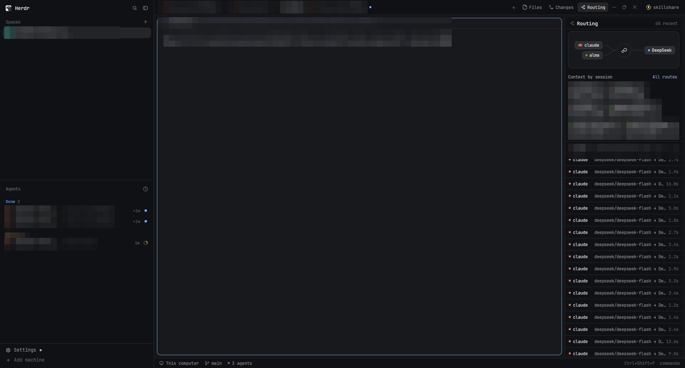
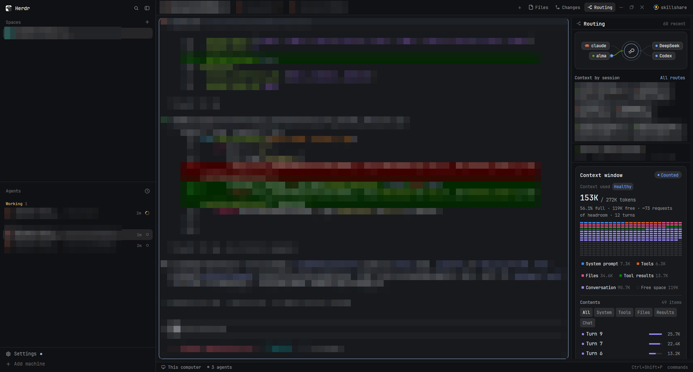

# Magpie Routing

A Herdr workspace based on `herdr-skillshare`, with a live Magpie routing panel. The top bar adds a Routing toggle beside Files and Changes. The panel shows agent-to-model routes and lets you select a session to inspect its Context window.

## What you see

- The standard Herdr Spaces and Agents sidebar stays on the left.
- The active terminal workspace fills the center.
- The Routing panel opens on the right; its animated route view connects agents, a routing hub, and destination models.
- Context-by-session cards below the route view show token use, context parts, and available item metadata.
- Skillshare remains available as a separate panel and starts hidden.

## How it works

- `mods/routing` watches Magpie's local `~/.config/magpie/routing/*.jsonl` records and refreshes from disk. It displays the route and context metadata in those records; it does not fetch conversation bodies from Magpie's private GUI API.
- `mods/tabs-routing` adds the Routing toggle beside Files and Changes.
- `mods/skillshare` is included because the layout is based on the Skillshare layout.
- Select a session in “Context by session” to show its latest available context window. If Magpie has not written routing records, the panel stays empty.

The animation follows Magpie's Routing design. GPUI does not expose arbitrary-path keyframes, so the flying dots use native transitions between points along the Bezier wires.

## Install

Tested with Herdr app 0.1.14. Copy `layouts/magpie-routing-v1.json` and `layouts/magpie-routing-v1.svg` into Herdr's `layouts/` folder, and the three folders under `mods/` into Herdr's `mods/`. Back up any same-named mods before replacing them. Switch to the layout and run `herdr-app check` on each mod.

Routing data appears when Magpie is writing local routing JSONL files. Skillshare features require the `skillshare` CLI.

## Source

Inspired by [lexrus's X post and its comments](https://x.com/lexrus/status/2119443089760960679). The starting prompt was approximately:

> Read `~/.config/herdr-app/AGENTS.md`, then read the local Magpie source `{local git repository path}`. Reproduce the Routing interface animation and implement a Herdr mod that displays routes live, with a Routing toggle beside Files and Changes.

The prompt and implementation may need adjustment for the model and local setup.
